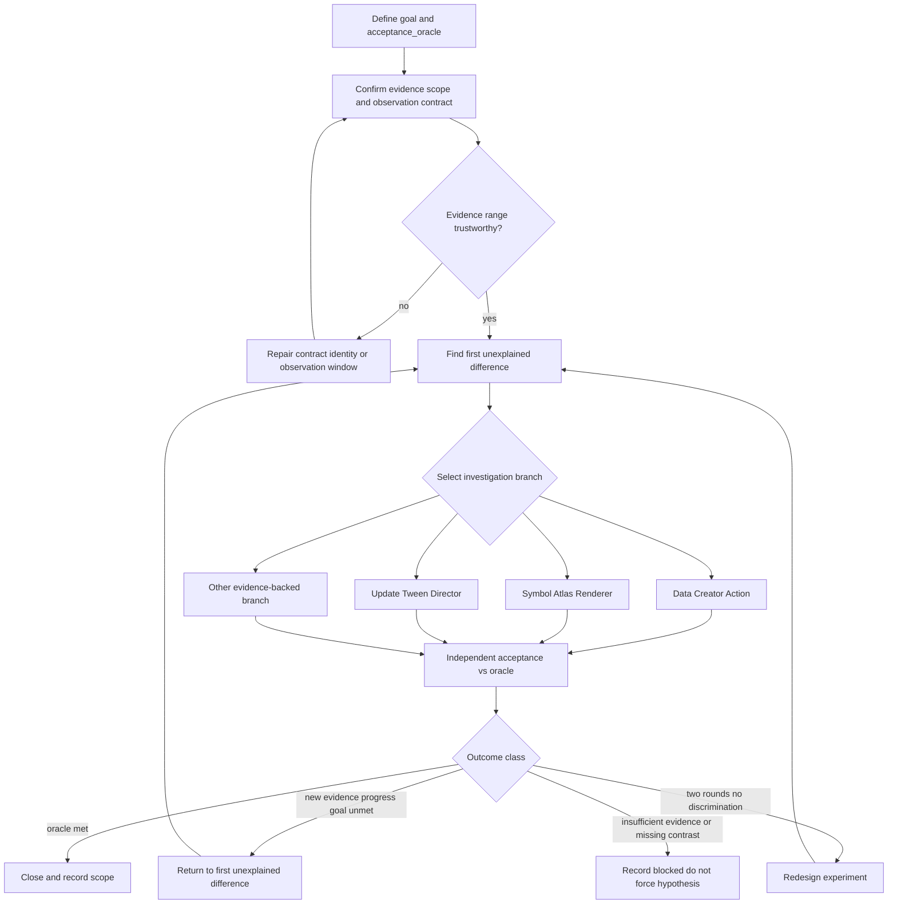

# Unity Analysis Decision Workflow

授權 Unity／IL2CPP 分析的**決策入口**：定義目標、管理假設、選擇最小區分實驗、裁決證據與結案。
不重複 Frida／資產解析步驟——那些在 [`workflows/`](workflows/README.md)。

**先讀本檔**，再依證據進入單一 procedure。端到端編排與交付 gate 仍由 [`workflow/apk-analysis/execution-flow.md`](../../workflow/apk-analysis/execution-flow.md) 負責。

跨目標主張品質沿用 [`../reverse-engineering/evidence-contract.md`](../reverse-engineering/evidence-contract.md) 的 Observation／Inference／Residual unknown——**不另造第二套哲學**。

## 1. 共通前置 vs 調查分支

| 概念 | 內容 | 規則 |
| --- | --- | --- |
| **共通前置** | build／fixture、目標物件身分、方法／觀測契約、觀測窗口是否足以支持目前判斷 | 每次確認「證據範圍可信」；已驗證 ABI 可沿用，但須確認 build、簽名、物件仍在先前範圍內——**不必每次重跑整套契約** |
| **調查分支** | 資料／Creator／Action；Symbol／Atlas／Renderer；Update／Tween／Director；其他證據支持的分支 | 依**第一個未解釋的差異**選路，不是固定線性流水線 |

### 分支指引（例）

| 第一個未解釋差異 | 優先 procedure |
| --- | --- |
| GetContent null／錯物件／ABI 可疑 | [`il2cpp-runtime-contract-validation`](workflows/il2cpp-runtime-contract-validation.md) 或內容建立鏈 |
| 內容／State／Creator 未進場 | [`unity-soft-visual-restore`](workflows/unity-soft-visual-restore.md) 資料段 |
| 內容對但無 glyph／atlas | 資產／綁定（[`unity-asset-parse-flow`](workflows/unity-asset-parse-flow.md)）再 runtime 交叉 |
| paint 後彈回 | soft-restore 停驅動段或 [`unity-fx-driver-trace`](workflows/unity-fx-driver-trace.md) |
| Animator 命中但視覺缺口 | fx-driver-trace |

## 2. 證據陳述 vs 裁決狀態（分欄）

| 來源 | 欄位 | 用途 |
| --- | --- | --- |
| RE evidence-contract | Observation／Inference／Residual unknown | 主張類別 |
| 本決策域 | `observed`／`supported`／`ruled-out-in-scope`／`not-tested`／`blocked` | 裁決狀態 |
| 範圍 | build、fixture、物件身分、時間窗口、掃描範圍 | 結論適用邊界 |

禁止把裁決狀態與 Observation／Inference／Unknown 混成同一欄。

## 3. `acceptance_oracle` 與成熟度標籤

每個案例必須宣告 **`acceptance_oracle`**：能區分成功、失敗與證據不足。

**獨立驗收**：驗收依據與產生結果的那次呼叫必須可分開；禁止僅用同一 API 的 `invoke=true` 證明自己成功。

可獨立成立（非強制階梯）：

| 標籤 | 含義 |
| --- | --- |
| `contract-verified` | 方法、簽名、參數及物件契約已驗證 |
| `data-verified` | 資料讀回符合目標 |
| `binding-verified` | runtime 資料與視覺資產引用已證實 |
| `natural-path-verified` | 自然流程關鍵事件與資料已對齊 |
| `visual-verified` | 目標畫面在指定窗口符合要求 |
| `end-to-end-verified` | 該案所有**必要**條件均通過 |

靜態資產盤點不必為湊 `visual-verified` 而跑 live。視覺還原（如 soft-enter）的 oracle 常組合：物件身分 + getter／等價讀回 + settle 畫面 + 範圍限制。

## 4. 最小區分實驗

每次實驗至少具備（見 [`case-ledger-template.md`](case-ledger-template.md)）：

| 欄位 | 用途 |
| --- | --- |
| `question` | 本輪要回答什麼 |
| `expected_if_h1`／`expected_if_h2` | 兩假設各自預測 |
| `falsifier` | 什麼結果反駁目前假設 |
| `observation`／`result` | 實際看到什麼 |
| `decision_after_result` | 支持／排除／仍不明／blocked |
| `side_effect_and_rollback` | 副作用與解除方式 |

自然路徑 vs 人工 force：**force 只能標 lab overlay／驅動已鎖**；缺自然對照維持 `blocked`，不可當已排除。

連續兩輪未能區分假設 → **重新審查實驗設計**（不是必然結束）；證據不足 → 記 `blocked`，不要強選假設。

## 5. 停止與結案

結案紀錄至少含：`acceptance_oracle` 結果、物件身分、證據範圍、已支持／排除／blocked 假設、下一個最小步驟（若未完成）。

## 6. 5×2 soft-enter 示範（對照，非再加 force）

| | 自然進盤 | Soft-enter |
| --- | --- | --- |
| 畫面 | 5×2 有字 | Chrome／空石殼 |
| 常見觀測 | Create／Show 等曾命中 | GetContent 仍 null |
| 角色 | **基準組** | **待解釋** |

下一步：同類型對照資料、物件身分、Creator 輸出、事件序 → 找第一個差異 → 單一區分實驗 → getter／settle 驗收。
`_Symbol`／atlas 可保留為假設，**不**升格為已確認根因，直到有支持＋反證窗口。

## Related

- Procedure index: [`workflows/README.md`](workflows/README.md)
- Domain hub: [`README.md`](README.md)
- Case ledger: [`case-ledger-template.md`](case-ledger-template.md)
- APK handoff: [`../apk/README.md`](../apk/README.md)
