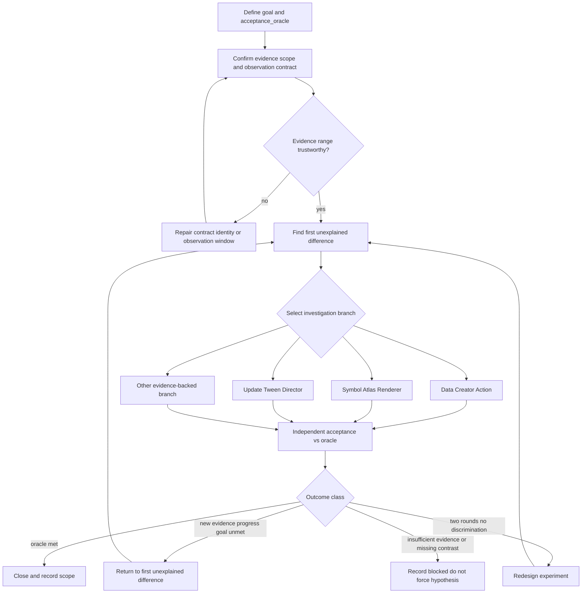

# Unity 分析決策域落地（`analysis/unity`）

**Status**: `in-progress`（Phase 0 **proceed**；Phase 1 結構性驗收 **PASS**；Phase 2 待專案 dogfood）

**Review incorporation（2026-10-29）**：採納 stakeholder 審查——修正分層／完成門檻／證據契約／Phase 0 出口／Phase 1 遷移驗收／case ledger 精簡／ADR 與 Phase 2 分離；不推翻 Goal、Non-goals、Layer map、Target tree、Phase 3 暫緩。

**Phase 0 decision（2026-10-29）**: **proceed** — 詳 [`evidence/phase0-preflight-baseline.md`](evidence/phase0-preflight-baseline.md)。
**Phase 1（2026-10-29）**: **PASS** — 詳 [`evidence/phase1-structural-acceptance.md`](evidence/phase1-structural-acceptance.md)。

## Goal

把 Unity／IL2CPP 分析從「沿最新 hook 追」改成「決策入口 → 假設裁決 → 最小區分實驗 → 完成驗證」；在 `analysis/unity/` 建立專屬 SoT，既有四份技術 procedure 遷入該域，`analysis/apk` 只保留指引。

## Non-goals

- 合併三份 Unity 技術 workflow
- 新增大型 Unity runtime／平行 orchestrator YAML
- 現在就把決策機械化進 `runtime.db`
- 把業務 5×2 raw evidence 寫進 Ai-skill
- 把「每週審查」做成 hook／commit gate
- 另建第二套通用證據理論（必須引用既有 RE evidence-contract）

## Diagnosis

現有程序夠用，但缺共同決策層：

| 現況檔（已遷入 `analysis/unity/workflows/`；apk 僅 stub） | 角色 |
| --- | --- |
| [`unity-asset-parse-flow.md`](../../../analysis/unity/workflows/unity-asset-parse-flow.md) | 資產／粒子解析 |
| [`unity-fx-driver-trace.md`](../../../analysis/unity/workflows/unity-fx-driver-trace.md) | 動畫／特效驅動追蹤 |
| [`unity-soft-visual-restore.md`](../../../analysis/unity/workflows/unity-soft-visual-restore.md) | soft 視覺還原順序 |
| [`il2cpp-runtime-contract-validation.md`](../../../analysis/unity/workflows/il2cpp-runtime-contract-validation.md) | IL2CPP 契約 |

缺口：觀測≠因果、假設≠根因、實驗未設計成區分原因、局部成功（invoke）與整體完成混用。

正確補丁：**專屬 `analysis/unity` 決策層 + 既有 procedure 搬家成該域 HOW-TO-COLLECT，`analysis/apk` 只指引過去**——不是再寫技術手冊、也不是合併三份 workflow。

## Layer map

| 層 | 職責 | Unity 對應 |
| --- | --- | --- |
| `analysis/unity/` | 決策＋Unity／IL2CPP 取證程序 | **新建 SoT** |
| `analysis/apk/` | Android／Frida／流量等 | 保留；Unity → stub／pointer |
| `workflow/apk-analysis/` | 端到端編排與完成 gate | 繼續；鏈到新路徑 |
| `intelligence/.../runtime-evidence-boundaries.md` | HOW TO THINK | 只改連結 |
| [`analysis/reverse-engineering/evidence-contract.md`](../../../analysis/reverse-engineering/evidence-contract.md) | 跨目標 Observation／Inference／Unknown | **引用，不複製** |
| 業務專案 evidence | 對照、截圖、物件位址 | 不進本庫 |

## Target tree

```text
analysis/unity/
├── README.md                      # 域介紹、索引、啟動條件、依賴（非決策 SoT）
├── decision-workflow.md           # 決策入口（route primary_source）
├── case-ledger-template.md        # 精簡帳本（6 必要欄；非 runtime）
└── workflows/
    ├── README.md
    ├── unity-asset-parse-flow.md
    ├── unity-fx-driver-trace.md
    ├── unity-soft-visual-restore.md
    └── il2cpp-runtime-contract-validation.md  # Phase 0 確認後遷移；通用原則改引用 RE
```

舊 `analysis/apk/workflows/unity-*.md` 與 `il2cpp-runtime-contract-validation.md` → **stub only**（單一 canonical link）。

## Decision model（P0 修正）

### 共通前置 vs 調查分支（禁止誤解成線性流水線）

| 概念 | 內容 | 規則 |
| --- | --- | --- |
| **共通前置條件** | build／fixture、目標物件身分、方法／觀測契約、觀測窗口是否足以支持目前判斷 | 每次案例都要確認「證據範圍可信」；**已驗證的 ABI 可沿用**，但須確認 build、簽名、物件條件仍在先前驗證範圍內——**不必每次重跑整套契約驗證** |
| **按證據選擇的調查分支** | 資料／Creator／Action；Symbol／Atlas／Renderer；Update／Tween／Director；其他由證據支持的分支 | 依**第一個未解釋的差異**選路，不是固定順序跑完全部 |



### 證據契約（跨層共用哲學 + Unity 形狀）

Phase 0 **必須先讀** [`evidence-contract.md`](../../../analysis/reverse-engineering/evidence-contract.md)，確認 Observation／Inference／Residual unknown 的實際定義。Unity 文件**只補充領域形狀**，不另造第二套分類。

| 通用（RE 契約） | Unity 領域補充（例） |
| --- | --- |
| Observation | 方法命中、getter 值、物件引用、畫面、資產引用 |
| Inference | 根因候選、因果關係、資料→視覺推論 |
| Residual unknown | 未解析 hook、未觀測窗口、尚未確認的 writer |
| （範圍欄） | build、fixture、物件身分、時間窗口、掃描範圍 |
| （裁決狀態，另欄） | `observed`／`supported`／`ruled-out-in-scope`／`not-tested`／`blocked` |

**禁止**：把 `observed`／`supported`／… 與 Observation／Inference／Unknown **混成同一個欄位**。前者是裁決狀態；後者是陳述類別。

### 完成門檻：目標導向 `acceptance_oracle`（非萬能 getter＋畫面）

每個案例必須宣告符合其目標的 **`acceptance_oracle`**：能區分成功、失敗與證據不足。

**獨立驗收**：驗收依據與「產生結果的那次呼叫」必須可分開；禁止僅用同一 API 的成功回傳證明自己成功（不要求第二個 Agent）。

可獨立成立的成熟度標籤（**非強制階梯**）：

| 標籤 | 含義 | 典型任務 |
| --- | --- | --- |
| `contract-verified` | 方法、簽名、參數及物件契約已驗證 | IL2CPP 契約 |
| `data-verified` | 資料讀回符合目標 | soft 內容圖 |
| `binding-verified` | runtime 資料與視覺資產引用已證實 | atlas／sprite |
| `natural-path-verified` | 自然流程關鍵事件與資料變化已對齊 | 對照組 |
| `visual-verified` | 目標畫面在指定窗口符合要求 | soft-enter 視覺 |
| `end-to-end-verified` | 該案例所有**必要**條件均通過 | 依 oracle 組合 |

靜態資產盤點／粒子參數解析可只用自身 oracle，**不必**為湊 `visual-verified` 而跑 live 遊戲。

視覺還原類（如 5×2）的 oracle 常組合：物件身分 + getter／等價讀回 + settle 畫面 + 範圍限制——但這是**該任務類型**的組合，不是全域硬性條件。

### 最小實驗裁決欄位

每次區分實驗至少具備（可寫在 case ledger；不必 YAML）：

| 欄位 | 用途 |
| --- | --- |
| `question` | 本輪要回答什麼 |
| `expected_if_h1` / `expected_if_h2` | 兩假設各自預測 |
| `falsifier` | 什麼結果會反駁目前假設 |
| `observation` / `result` | 實際看到什麼 |
| `decision_after_result` | 支持／排除／仍不明／blocked |
| `side_effect_and_rollback` | 副作用與如何解除 |

若連續兩輪實驗**未能區分假設** → 觸發**重新審查實驗設計**（不是必然結束任務）；重新設計後仍可進行有充分理由的新實驗。

自然路徑 vs 人工 force：**force 只能標 lab overlay／驅動已鎖**；缺自然對照維持 `blocked`，不可當已排除。

### Case ledger 必要欄位（精簡）

模板預設只要求六項；其餘按需展開：

1. `target_outcome`
2. `acceptance_oracle`
3. `evidence_scope`
4. `hypotheses`
5. `next_experiment`（含上表裁決欄位）
6. `conclusion`

未知可留白，但必須標明**哪些未知會影響判斷**。避免帳本維護壓過調查。

### `decision-workflow.md` 交付清單

1. 決策入口：目標 → 假設 → 最小區分實驗 → 裁決 → 結案／停止（含 redesign 觸發）
2. 共通前置 vs 證據驅動分支（如上）
3. RE 證據契約引用 + Unity 形狀表；裁決狀態另欄
4. `acceptance_oracle` + 成熟度標籤 + 獨立驗收定義
5. 自然／force 隔離；5×2 soft-enter 示範（找第一個差異，不是再加 force）
6. 精簡 case ledger 模板連結

四份技術文件頂部：**先讀 `../decision-workflow.md`**；步驟不大改，只修相對連結。

## Phases

### Phase 0 — Architecture Compatibility Preflight

#### Open Questions 核對

| Open Question | 處置 | 證據／原因 |
| --- | --- | --- |
| Q1 primary_source | **resolved** | `decision-workflow.md`；README 非決策 SoT |
| Q2 il2cpp 遷移 | **resolved-with-condition → Phase 0 已確認可遷移** | 檔案主體為 IL2CPP／Unity runtime 契約方法；未另定義 Observation／Inference；遷移後只引用 RE 契約，不複製 |
| Q3 每週審查 | **deferred** | README 可選建議；不做 hook／gate |
| Q4 Phase 2 阻塞 Phase 1？ | **resolved** | 不阻塞 merge；Phase 1 結構性驗收仍必過 |

#### Checklist（相容性與影響面，不只檔案存在）

- [x] 讀 [`evidence-contract.md`](../../../analysis/reverse-engineering/evidence-contract.md)；Unity 只補充形狀、不複製哲學（見 evidence）
- [x] Candidate files：四份 procedure、routing-registry、unity-fx discovery／summary／CLI 皆存在
- [x] **舊路徑使用者盤點**：見 [`evidence/phase0-preflight-baseline.md`](evidence/phase0-preflight-baseline.md) §Consumers
- [x] **相對連結完整性**：遷移計畫 = 同目錄相對連結保持；對外改 `analysis/unity/workflows/`；apk 舊路徑 stub
- [x] SoT／Layer：canonical = `analysis/unity/`；編排仍 `workflow/apk-analysis`；apk stub only
- [x] **Discovery 訊號所有權**：現有 `route.analysis.unity-fx` 已用 Animator.Play／m_Payloads／PlayableDirector／Unity*；新 `route.analysis.unity` 沿用同族＋ soft／GetContent／UnityPy／IL2CPP contract，**不**綁 `*.apk`／泛用 Frida（與 apk.workflows de-dup 一致）
- [x] **遷移前基線（可比較產物）**：[`evidence/phase0-preflight-baseline.md`](evidence/phase0-preflight-baseline.md) + 附錄命令輸出摘要（非僅 checklist）
- [x] Q2 條件確認：可遷移
- [x] Linked updates 清單：見 evidence §Must-update-in-Phase-1

#### Phase 0 出口條件（決策閘門）

| Decision | 何時選 |
| --- | --- |
| **proceed** | SoT、遷移範圍、依賴、驗證方式與 Open Questions 已確認；無未解架構衝突 |
| **revise** | 發現跨域依賴、路由衝突、或無法安全遷移的內容 → 先修 plan |
| **ask user** | 僅架構責任、偏好、或 repo 證據無法裁決的事項 |

#### Phase 0 裁決（已記錄）

| 欄位 | 值 |
| --- | --- |
| **Decision** | **proceed** |
| Checked sources | RE evidence-contract；四份 Unity／IL2CPP procedure；routing-registry `route.analysis.unity-fx`／`apk.workflows`；`unity_fx_discovery.go`；validation scenario；workflow/apk-analysis 連結 |
| Conflicts | **無**架構衝突；il2cpp 可遷入 unity 域；feedback history 舊路徑 → Phase 1 後補批次改寫至 `analysis/unity/workflows/…`（stub 仍保留給未更新引用） |
| Interrogation | Goal／non-goals／acceptance 已凍結於本 plan；duplication risk = apk 全文副本 → 以 stub-only 消除 |
| Open Questions | Q1–Q4 已裁決；無 still-open blocker |
| Validation | `go test … TestUnityFX` PASS；`runtime validate --assert-source analysis/apk/workflows/unity-fx-driver-trace.md` PASS；產物見 evidence |
| Next | 進入 Phase 1 遷移與結構性驗收；**不**等 Phase 2；**不**做 Phase 3 |

### Phase 1 — 落地決策域與遷移

**結構性驗收**（與 Phase 2 案例驗證分開；**不可省略**）— **6/6 PASS**（見 [`evidence/phase1-structural-acceptance.md`](evidence/phase1-structural-acceptance.md)）：

| 驗收 | 標準 | Status |
| --- | --- | --- |
| SoT 唯一 | apk 舊路徑僅 stub；全文只在 `analysis/unity/` | **PASS** |
| 舊入口仍有效 | Markdown／YAML／Go／腳本／測試／生成規則＋feedback history 必要更新 | **PASS** |
| 連結有效 | 四份 procedure + README／decision 相對連結有效 | **PASS** |
| Routing 正向 | Unity 專屬任務命中 `decision-workflow`／unity-fx | **PASS**（`TestUnityDecisionRoutePositive…`） |
| Routing 負向 | 一般 APK／泛用 Frida 不誤導向 Unity | **PASS**（同 test negative cases） |
| 工具與 Discovery | compile／refresh／Unity discovery／RAG；對照 Phase 0 無意外退化 | **PASS** |

工作項：

- [x] 寫 `analysis/unity/README.md`、`decision-workflow.md`、`case-ledger-template.md`、`workflows/README.md`（依上節契約）
- [x] `git mv` 四份 procedure（含 il2cpp）；舊路徑 stub
- [x] 依舊路徑盤點更新硬編碼消費者
- [x] Registry：`route.analysis.unity`；改 `route.analysis.unity-fx`；trim apk.workflows；apk-analysis candidate 加 unity README
- [x] summary／discovery scenario／`unity_fx_discovery.go`／intelligence Related；重建 `ai-skill-darwin-arm64`
- [x] compile + refresh + 結構性驗收表勾選（見 evidence）
- [x] feedback history／extraction 舊 Unity／IL2CPP 路徑改寫至 `analysis/unity/workflows/…`
- [x] 正向＋負向 routing handoff Go test（`unity_route_handoff_test.go`）

### Phase 2 — 5×2 soft-enter 試跑（專案側；不阻塞 Phase 1 merge）

- [ ] 精簡 case ledger：自然 vs soft 同類型對照
- [ ] 找出第一個必要差異，或寫清證據不足／`blocked`
- [ ] `_Symbol`／atlas 維持假設不升格；Soft49 缺對照標 `blocked`
- [ ] **通過含義**：決策域**值得繼續使用**（單一案例有效）——**不**自動等於 ADR 成立

### Phase 3 — 機械化（暫緩）

僅當 Phase 2 後仍反覆漏帳本／混層完成時再評估。**現在不做。**

## Open Questions

| # | Question | Status | Adjudication |
| --- | --- | --- | --- |
| Q1 | `primary_source`？ | **resolved** | `analysis/unity/decision-workflow.md`；README = 介紹／索引／依賴 |
| Q2 | il2cpp 是否遷移？ | **resolved-with-condition** | 預設遷移；Phase 0 確認範圍；通用原則引用 RE |
| Q3 | 每週審查制度化？ | **deferred** | README 可選；無 hook／gate |
| Q4 | Phase 2 阻塞 Phase 1 merge？ | **resolved** | 不阻塞；Phase 1 結構性驗收仍必過 |

## Decision Rationale

### Why now

技術程序已累積，但分析不收斂。補決策層比再寫技術手冊更能縮短無效實驗。

### Alternatives rejected

- 只加長單一 procedure／合併三份／立刻 runtime／繼續塞在 `analysis/apk/workflows`
- 把 getter＋畫面當全域完成條件（審查否決）
- 另建第二套 Observation／Inference 理論（審查否決）

### Why Not an ADR Yet

Phase 2 單案通過 ≠ 跨案例／跨專案架構成立。維持 analysis 域文件即可；有足夠跨案例重用證據再評估 ADR。若試跑證明只需輕量入口，**不必為完整性升 ADR**。

### ADR Promotion Criteria

**分開兩層：**

| 層 | 通過標準 | 含義 |
| --- | --- | --- |
| Phase 2 | 決策流程在該案找出第一個差異或明確 blocked | 決策域值得繼續用 |
| ADR 候選 | foundational + cross-session + cross-project + expensive-to-reverse + explains-why；**且**跨案例重用證據充足；Open Questions 已結；無更輕 promotion target | 才評估升 ADR |

- [ ] Phase 2 單案有效（必要但不充分）
- [ ] 跨案例重用證據
- [ ] 五項 ADR 性質全中
- [ ] Open Questions 全解或 deferred
- [ ] 確認無需更輕 target

### Consequences／風險

- 正面：假設／證據／實驗／完成紀律；Unity 有明確 layer 家。
- 負面：遷移表面積；需 stub + 結構性驗收。
- 風險：雙 SoT；搶 Frida／apk signals；過重 case ledger → 已用六欄精簡緩解。

## Acceptance（整份 plan）

- [x] `analysis/unity/` 為決策＋procedure SoT；apk 僅 stub／指引
- [x] 決策模型含共通前置／分支、RE 引用、oracle、獨立驗收
- [x] Phase 1 結構性驗收表全過（含 routing 負向與遷移前後比較）
- [x] Phase 3 未提前實作
- [ ] ADR 未僅因單案 Phase 2 而強制升級（Phase 2 尚未跑）
- [ ] Plan Completion Closure（待 Phase 2 決策後）

## Weekly review（非 gate）

`analysis/unity/README.md` 可選節奏：本週證據、失敗假設、下一個最小實驗——**不**進 commit-msg／hook。

## Explicitly out of scope

- 合併三份 Unity 技術 workflow
- 大型 Unity runtime／第二套 orchestrator
- 業務 raw evidence 進庫
- 每週審查機械 enforcement
- 第二套通用證據哲學
